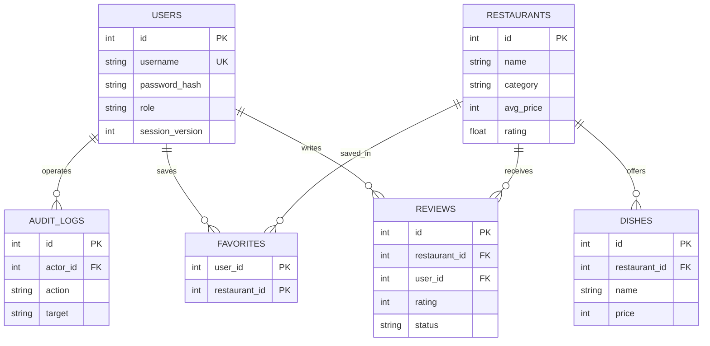

# 寻味：美食点评平台课程项目说明

## 一、项目目标

“寻味”是一个虚构商家数据驱动的美食点评平台。项目用一个完整的浏览、点评、收藏和运营闭环展示 Python Web 开发能力：用户能发现餐厅并留下体验，管理员能维护餐厅资料和处理点评，所有结果可以在页面和数据库中核对。

本项目适合课程答辩和个人作品集。示例商家、地址、电话和点评均为虚构数据，不代表真实平台或真实商家。

## 二、角色与需求

| 角色 | 主要任务 | 实现方式 |
| --- | --- | --- |
| 游客 | 搜索、筛选、查看餐厅、临时收藏 | 无需账号，收藏存于浏览器 |
| 注册用户 | 持久收藏、发布和管理自己的点评、修改密码 | 服务端账号与权限校验 |
| 管理员 | 维护餐厅和菜品、审核点评、启停用户、查看操作记录 | 独立后台，所有写操作记录日志 |

典型使用过程：食客搜索菜品 → 查看餐厅和公开评分 → 注册或登录 → 收藏并点评 → 在个人中心修改点评。管理员可在后台隐藏不合适的点评，公开评分随之重算。

## 三、技术方案

- 后端：Python 3.11+、Flask、Werkzeug、Waitress。
- 数据：SQLite。按版本迁移旧库，升级前备份。
- 前端：Jinja2 模板、原生 CSS 和 JavaScript，无前端构建步骤。
- 验证：Python 标准库 `unittest`；安装脚本和源码包可复现首装。

程序采用 Flask 应用工厂。`catalog`、`accounts`、`reviews`、`favorites` 和 `admin` 五个模块分别处理浏览、账号、点评、收藏与后台；`db`、`migrations`、`security` 和 `services` 处理数据和共用逻辑。这样可分别扩展业务，而无需持续扩大单个入口文件。

## 四、主要数据关系

历史演示点评允许 `user_id` 为空，因此不归属任何注册用户。`rating` 是由公开点评计算的缓存；隐藏、恢复、编辑、删除点评后都会更新。

## 五、实现难点与处理

1. **演示版数据兼容。** 新版只增加表和字段；迁移前调用 SQLite Backup API 生成数据库副本，并用版本号防止旧程序处理更新的库。
2. **收藏从游客过渡到账号。** 浏览器本地 ID 在登录后调用幂等合并接口，成功后才清除本地副本；筛选查询先确定全部匹配结果，再做分页。
3. **点评权限与统计一致。** 用户只能操作自己的点评；管理员可审核。公开评分和数量只统计 `visible` 状态，避免隐藏内容继续影响排序。
4. **会话安全。** 密码哈希存储、写请求 CSRF 校验、登录失败次数限制；修改密码或停用账号时递增会话版本，让旧登录失效。
5. **交付可复现。** 源码包不携带业务数据库、密钥或本机依赖；接收方通过脚本创建虚拟环境和演示数据库。

## 六、验证结果

项目提供 22 项自动化测试，覆盖初始数据、旧库迁移、备份、登录注册、CSRF、收藏合并、点评归属、后台权限、菜品管理、审核统计、密码失效和登录限流。测试使用临时数据库，不修改演示库。

将交付压缩包解压到独立临时目录后，已实际运行 `setup.ps1 -Demo` 完成依赖安装和初始化，并再次运行全部测试。Waitress 服务的首页与健康检查返回 200；未登录访问后台返回 403。

## 七、演示与后续边界

答辩建议依次展示：游客搜索和收藏、用户点评及个人中心、管理员维护菜品和审核点评、数据库备份与测试命令。具体操作见 [验收步骤](acceptance.md)。

当前交付定位为可本地运行的课程项目，没有接入真实商家数据、地图、图片上传、支付、短信邮件或公开服务器。若未来转为真实平台，应先确定目标城市、商家信息来源和内容审核规则，再设计身份核验、运营流程及部署监控。
